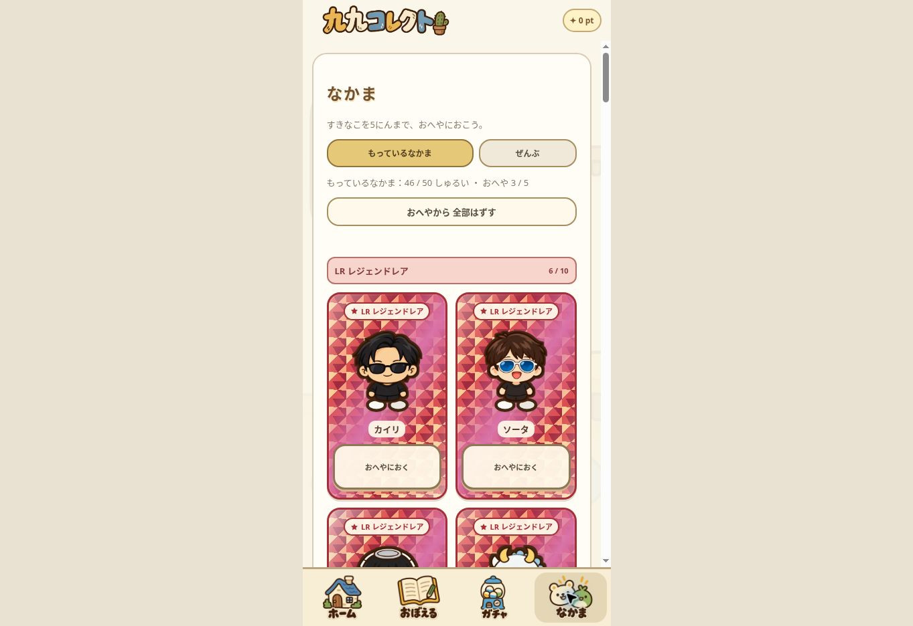
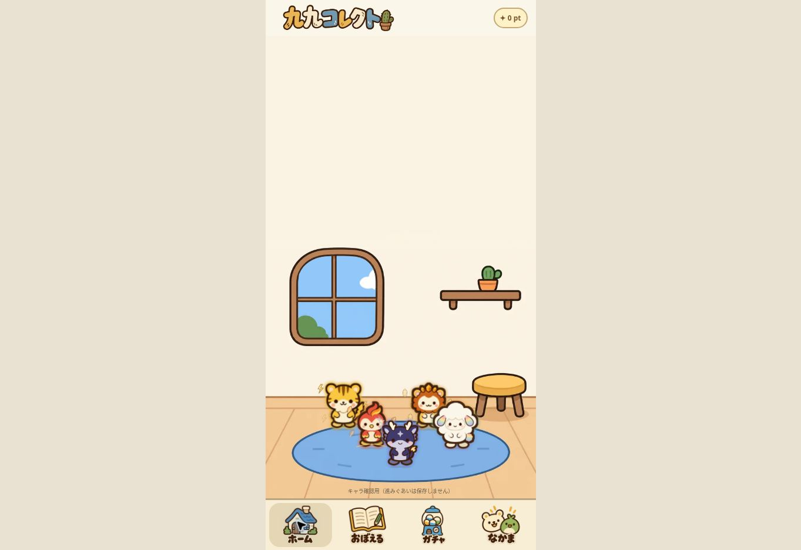
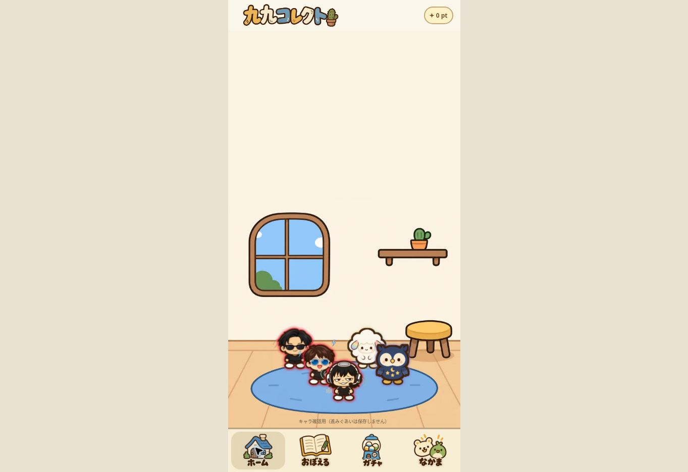
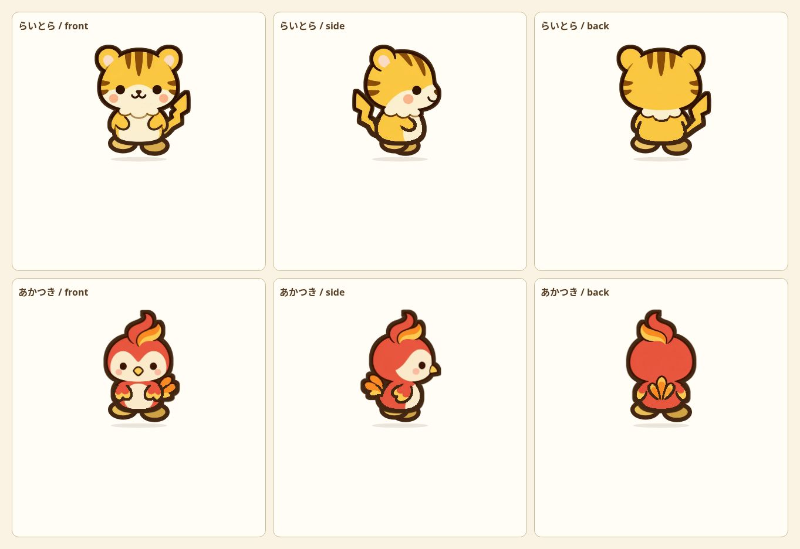
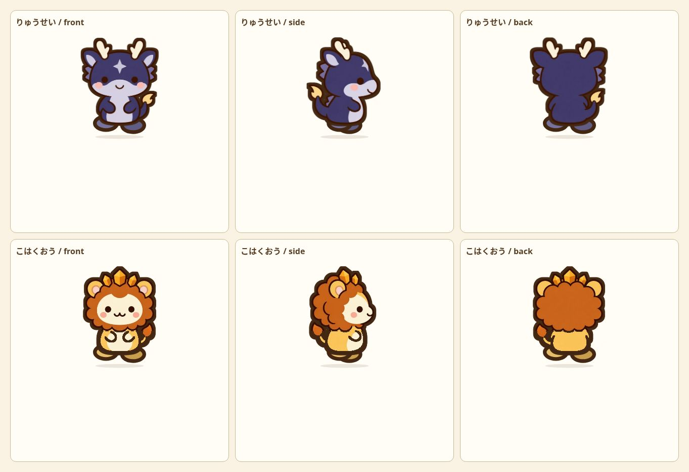

# 50-companion release and collection review

Date: 2026-11-01 (JST)

## Result

Added IDs 46–49: らいとら, あかつき, りゅうせい, こはくおう. Total 50 companions: N20 / R10 / SR10 / LR10. Existing IDs 0–45, names (including ソータ), rarities, original rig metadata and room order are preserved.

All ten LR companions now combine a character-specific motif with an alpha-silhouette aura. HBK retains its established crimson aura.

| ID | Companion | Individual effect | Aura |
|---|---|---|---|
| 3 | カイリ | Diagonal light streaks | Crimson |
| 4 | ソータ | Blue electrical shards | Crimson |
| 5 | カッパ | Sound waves | Crimson |
| 13 | つきしろ | White-gold walking trail | Lavender |
| 14 | にじぽぽ | Rainbow above the head | Vertical rainbow |
| 16 | よるまる | Stars and belly glow | Night violet |
| 46 | らいとら | Golden lightning bolts | Gold |
| 47 | あかつき | Rising flame feathers | Vermilion |
| 48 | りゅうせい | Comet and starlight | Indigo-lilac |
| 49 | こはくおう | Floating amber crystals | Amber |

## Collection

- Groups appear in LR → SR → R → N order, each with owned/total counts.
- Initial view shows only owned companions. The “ぜんぶ” button includes locked question-mark cards.
- Room membership remains a badge/outline that does not affect card layout.
- The normal URL no longer automatically unlocks the roster.
- Explicit `?preview-roster=1` displays all companions in an in-memory preview. Preview placement, quizzes and draws do not write the real save.
- Existing grants already saved by the earlier test mode are preserved; this release does not erase ownership, points, learning progress or favorites.

## Artwork and calibration

Produced four individual three-view atlases with built-in image_gen, using the existing companion-17.webp as a style reference. Final assets are [lr-46.webp](../../assets/lr-46.webp), [lr-47.webp](../../assets/lr-47.webp), [lr-48.webp](../../assets/lr-48.webp), and [lr-49.webp](../../assets/lr-49.webp). Exact prompts are in [prompts.json](prompts.json).

Each view is calibrated independently at a body height of 90. The common outer contour target and paw stroke width are 3.8, colour #432713. Alpha dilation adds to the outside contour only. Side-body anchors are derived from the lower torso, excluding the lifted tail. Crops, measured widths and per-view corrections are recorded in [measurements.json](measurements.json); final new rig configuration is in [rigs.json](rigs.json). Indigo-body fine-line thickening is disabled to preserve the dragon’s dark colours and original face/arm detail.

## Verification

- Reviewed all 50 companions at the same scale in front, side and back views. New four also inspected in large three-direction sheets.
- Placed every new companion on the real home screen and observed walking, direction changes and foot alignment.
- Inspected aura/effect wrappers and visible home rendering for all ten LR in two groups. Aura rendering unit checks exercise all three views and both facing directions.
- Same らいとら card measured 180.5 × 310.1875 CSS pixels before and after placement.
- Browser test: normal view contained 46 owned cards; “ぜんぶ” contained 50 cards with four locked cards. Rarity headings were LR 6/10, SR 10/10, R 10/10, N 20/20.
- After extensive preview rearrangement, returning to the normal URL still showed 46 owned characters, 0 points, and original favorites [0,1,2]. Default owned-only filter remained active.
- Unit checks cover fresh production users receiving no automatic unlocks, fresh previews making no save writes, existing progress preservation, grouping and filtering.
- Browser verification used a desktop browser. Phone hardware was not tested.

Run checks from repository root:

```sh
node verification/lr-addition/check.js
node verification/lr-addition/check_collection.js
```

## Screenshots











Full-roster sheets: [front](all-50-front.jpg), [side](all-50-side.jpg), [back](all-50-back.jpg).

