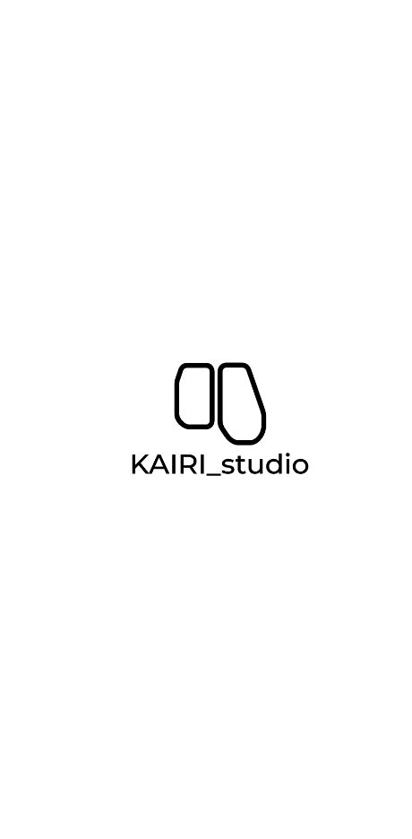
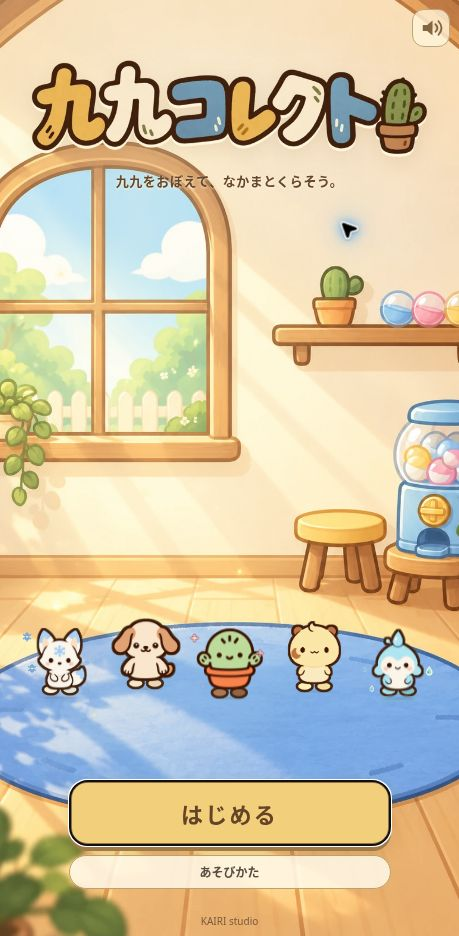
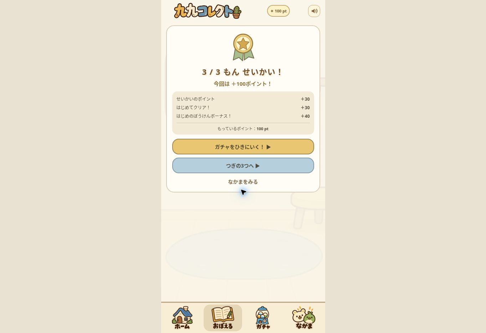
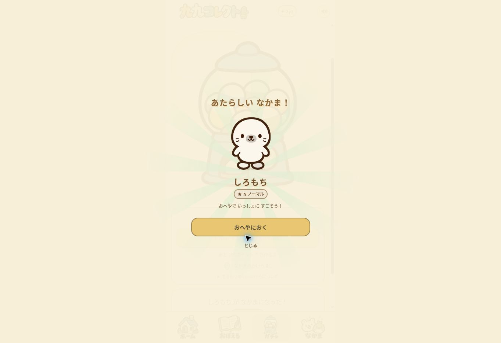

# Professional-polish release verification

Date: 2026-11-01 (JST)

## Implemented

1. KAIRI studio logo → dedicated illustrated title → start, with the same studio logo asset used by Cactus Factory. The existing game logo is reused. The title has floating existing mascots, help and an effects toggle; start uses the familiar upper/lower shutter transition.
2. Base draw odds: N55% / R25% / SR15% / LR5%. Within the selected rarity, missing characters are chosen before duplicates.
3. Duplicate rewards: N1 / R3 / SR8 / LR20 companion fragments. Missing companions can be exchanged for N10 / R30 / SR80 / LR160 fragments. Ownership and balance are validated before charging.
4. Learning: first correct answer to a question that day gives 10 points, focused review gives 15, and repeated correct answers that day give 2. First perfect clear of a normal three-question set adds 30 once. A new player's first perfect set adds a one-time 40-point start bonus, allowing the first three correct answers to reach 100 points.
5. Missed questions immediately enter the review recommendation. Successful items are scheduled for review in 1, 3 and 7 days; same-day repetition does not inflate mastery or push the due date forward. Daily reward accounting uses JST.
6. Results use an illustrated medal, point breakdown and a contextual main action: review mistakes, visit an affordable gacha, or continue learning. A focused review can return to its original uncleared set.
7. Gacha has a short shaking/splitting capsule animation, rarity-themed rays, character reveal and sound cues, plus skip. The result is saved once before animation; a busy guard prevents duplicate spending. The acquired companion can be placed directly in an available room slot.
8. Existing title/portrait/touch policy, 50-character identities, rarities, rig geometry, room ordering and the save key remain intact. All preview modes keep their changes in memory.

## Code

- index.html: existing game and startup markup.
- progression.js: testable reward, review, rarity, duplicate and exchange rules.
- polish.js / polish.css: launch screens and polished interaction.
- assets/title-room.webp: new background generated with built-in image_gen using the existing room as the style/world reference.
- assets/kairi-studio-logo.png: reused from KAIRI-studio/cactus-factory.

The obsolete uniform-random gacha and old flat-reward quiz handlers were removed from index.html; the new module owns those behaviors.

## Tests

Run from the repository root:

```sh
node --test verification/pro-polish/*.test.js
node verification/lr-addition/check.js
node verification/lr-addition/check_collection.js
```

Seven current automated tests pass. They cover existing save preservation, the exact first 100 points, no repeat clear/start bonus, same-day reward reduction, wrong-answer recommendation, spaced scheduling, JST day reset, rarity boundaries, unowned preference, duplicate compensation, exchange validation, launch-to-quiz-to-reveal integration and single-charge guards. The earlier character/aura/collection checks also pass.

## Live browser checks

- Logo appears, then automatically transitions to the title; start reaches the home.
- Help opens and closes. Title sound control is inside the upper-right corner.
- Fresh progress preview: 2×1, 2×2 and 2×3 answered correctly → 100 points (30 correct +30 first clear +40 start bonus).
- First draw consumed exactly 100 and revealed a new しろもち; direct room placement worked.
- A wrong 7×2 was offered as a one-question review. The successful review added 15 points.
- Repeating the earlier 2-times-table questions displayed a 2-point reward.
- Collection showed the fragment balance and locked-character exchange costs, with unaffordable exchange buttons disabled.
- Returning to the normal game after preview play still showed 46 owned companions, 0 points and original room order [0,1,2].
- All 50 character IDs/names/rarities/rig metadata match the prior release exactly.

Browser verification was on the desktop cloud browser, not physical phone hardware. SFX implementation was exercised but audio quality across devices has not been assessed.

## Review links

Normal game: https://kairi-studio.github.io/kuku-collect/

Fresh progress preview (no writes): ?preview-progress=1

Full roster preview (no writes): ?preview-roster=1

## Screenshots









