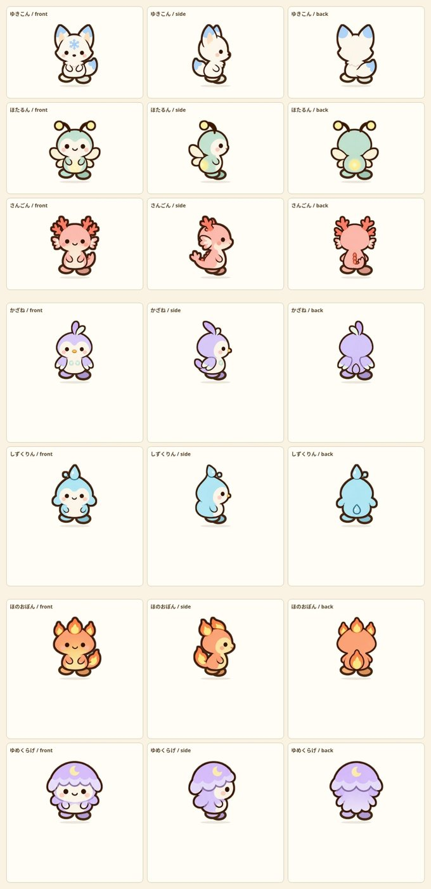
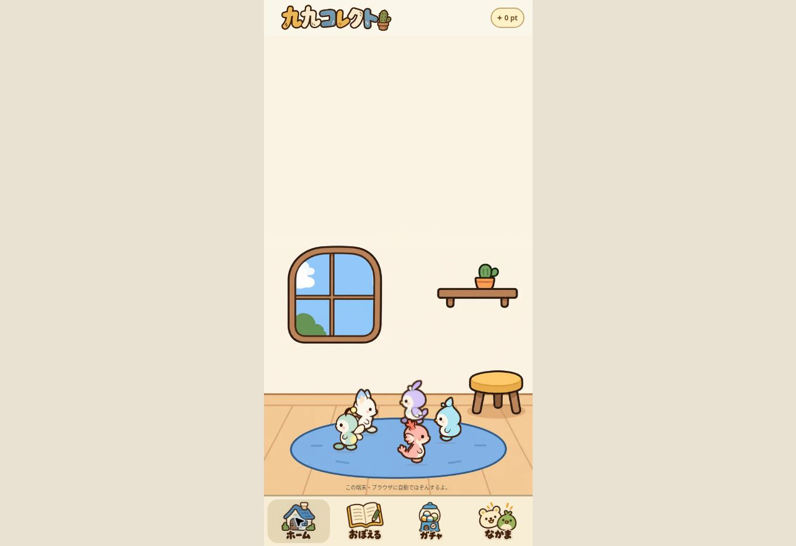
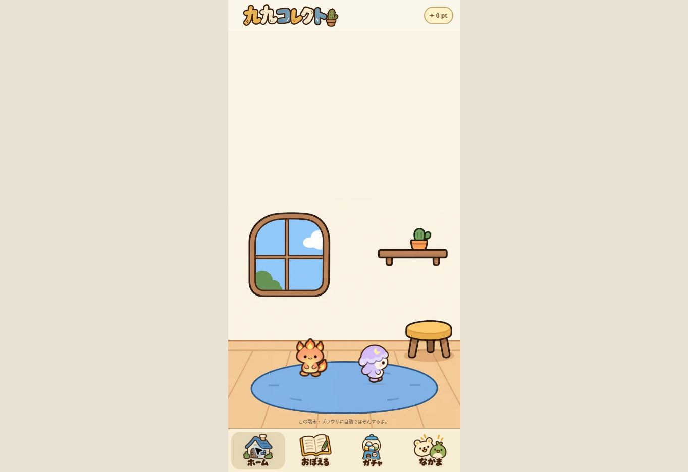

# SR companion addition verification

Date: 2026-11-01 (JST)

- Existing character IDs 0–38, rarity assignments, save key and saved placement logic are unchanged.
- Appended seven SR characters at IDs 39–45. Total 46: N20 / R10 / SR10 / LR6.
- Card membership label is absolutely positioned. Live browser measurement for the same card before/after selection: 180.5 × 302.1875 CSS pixels in both states.
- New front, side and back views checked at equal render scale; paws use the existing 3.8 outline width and #432713 colour.
- Outline compensation measured independently for every new view; body centres calibrated separately from tail-inclusive image centres.
- Scripts parse; all seven render functions produce three views and six paws, with valid atlas crops and no undefined attributes.

## Artwork

Built-in imagegen; one transparent 3-column × 7-row atlas matching the existing warm pastel, rounded brown-outline style. Every row is one new character in front/right-facing/back views; bodies omit feet so the existing game walk rig supplies the animated paws. Generated atlas split into assets/sr-39.webp through assets/sr-45.webp.

Names: ゆきこん / ほたるん / さんごん / かざね / しずくりん / ほのおぽん / ゆめくらげ

## Live home review

All seven added companions were placed on the real home screen and observed walking: IDs 39–43 together, then IDs 44–45. Direction changes and moving transforms were read from the rendered DOM; screenshots below record the actual home display. Original browser-test placement [0,1,2] was restored in the same order after verification. Browser points remained 0 throughout. Phone hardware was not tested.

